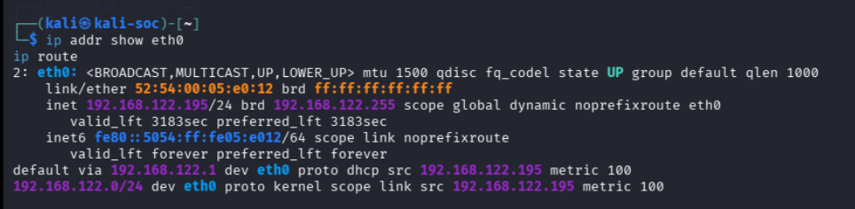
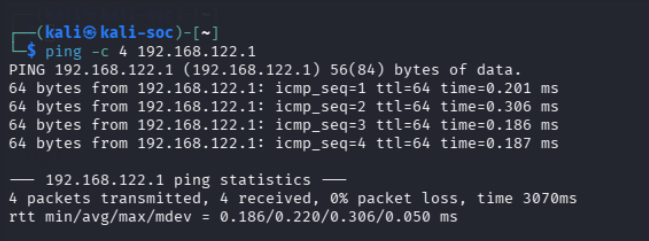
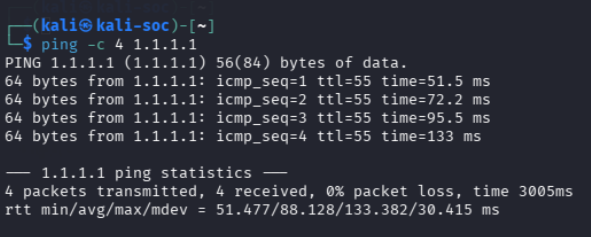
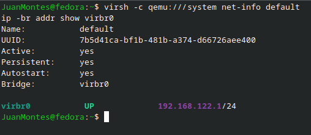

# Lab 02 — Network Fundamentals

## Overview

This lab investigates the network configuration of a Kali Linux virtual machine running on a Fedora Linux host using QEMU/KVM and libvirt.

The objective was to identify the guest's IP configuration, understand subnetting and routing, test network connectivity, verify DNS resolution, and examine the host's virtual NAT network.

---

## Environment

| Component | Details |
|---|---|
| Host operating system | Fedora KDE 44 |
| Guest operating system | Kali Linux Rolling |
| VM name | Kali-2026 |
| Guest hostname | kali-soc |
| Guest network interface | eth0 |
| Virtual network | libvirt `default` |
| Network mode | NAT |
| Virtual bridge | virbr0 |

---

## 1. Inspecting the Guest Network Interface

Commands used:

```bash
ip addr
ip -4 addr show dev eth0
ip route
```



*Screenshot 01: Kali's network configuration (`eth0`, `192.168.122.195/24`).*

### Findings

- IPv4 address: `192.168.122.195`
- Prefix length: `/24`
- Network interface: `eth0`
- MAC address: `52:54:00:05:e0:12`
- Default gateway: `192.168.122.1`
- Local subnet: `192.168.122.0/24`

The `/24` prefix corresponds to the subnet mask `255.255.255.0`. The subnet contains 256 IPv4 addresses, conventionally providing 254 usable host addresses.

The address `192.168.122.0` identifies the subnet, and `192.168.122.255` is its broadcast address. The gateway is `192.168.122.1`, while Kali received the address `192.168.122.195`.

The address was assigned dynamically through DHCP, rather than being configured as a manually assigned static address.

---

## 2. Inspecting the Routing Table

Command used:

```bash
ip route
```

Observed routes:

```text
default via 192.168.122.1 dev eth0 proto dhcp src 192.168.122.195 metric 100
192.168.122.0/24 dev eth0 proto kernel scope link src 192.168.122.195 metric 100
```

### What this demonstrates

- The connected route allows Kali to reach devices on its local subnet.
- The default route directs traffic for destinations outside the local subnet through `192.168.122.1`.
- The `src` field identifies the source IPv4 address selected for the route.

I also ran:

```bash
ip route get 1.1.1.1
```

The result selected gateway `192.168.122.1`, interface `eth0`, and source address `192.168.122.195` for the destination `1.1.1.1`.

---

## 3. Checking DNS Configuration and Resolution

Commands used:

```bash
cat /etc/resolv.conf
getent ahosts google.com
```

The resolver configuration showed:

```text
nameserver 192.168.122.1
```

The `getent ahosts google.com` command returned IPv4 and IPv6 addresses for the hostname.

### What this demonstrates

DNS resolution was working at the time of testing. Kali was configured to use `192.168.122.1` as its DNS server, and the hostname lookup returned address records.

The configuration identifies the DNS server Kali uses; it does not, by itself, prove which upstream DNS servers or forwarding path were used.

---

## 4. Testing Gateway Connectivity

Command used:

```bash
ping -c 4 192.168.122.1
```



*Screenshot 02: Ping test from Kali to the virtual gateway.*

### Result

- Packets transmitted: 4
- Packets received: 4
- Packet loss: 0%
- Average round-trip time: approximately 0.224 ms

### What this demonstrates

Kali successfully exchanged ICMP echo requests and replies with its virtual gateway. The low round-trip time is consistent with communication over the local virtual network.

---

## 5. Testing External IP Connectivity

Command used:

```bash
ping -c 4 1.1.1.1
```



*Screenshot 03: Ping test from Kali to the external IP address `1.1.1.1`.*

### Result

- Packets transmitted: 4
- Packets received: 4
- Packet loss: 0%
- Average round-trip time: approximately 148.480 ms

### What this demonstrates

The Kali guest could reach a public IP address using ICMP at the time of testing. Combined with the routing-table results, this supports the conclusion that the guest's outbound network path was working.

A successful ping does not prove that every network service or port is reachable. ICMP may also be filtered independently of other traffic.

---

## 6. Inspecting the Host's libvirt Network

These commands were run on the Fedora host, not inside Kali:

```bash
virsh -c qemu:///system net-info default
virsh -c qemu:///system net-dumpxml default
ip -br addr show virbr0
ip -br link show virbr0
```



*Screenshot 04: The libvirt `default` network and the `virbr0` bridge, viewed on the Fedora host.*

### Findings

- Network name: `default`
- Network status: active
- Persistent: yes
- Autostart: yes
- Bridge: `virbr0`
- Bridge IPv4 address: `192.168.122.1/24`
- NAT forwarding: enabled
- Configured DHCP range: `192.168.122.2` to `192.168.122.254`

The bridge's MAC address was `52:54:00:c1:0c:37`. This differs from the Kali guest's virtual NIC MAC address, as expected.

### What NAT means here

Network Address Translation allows the virtual machine to use its private address while outbound traffic is forwarded through the host's virtual networking setup. The guest does not need its own directly public IPv4 address for ordinary outbound connectivity.

NAT is a networking arrangement, not a guarantee of complete isolation or security. Exposure and isolation also depend on firewall rules, forwarding configuration, and other host settings.

---

## Evidence

Screenshots are stored in the `screenshots/` folder.

| File | What it shows |
|---|---|
| [`01-kali-network-config.png`](screenshots/01-kali-network-config.png) | Kali network configuration |
| [`02-gateway-connectivity.png`](screenshots/02-gateway-connectivity.png) | Gateway connectivity test |
| [`03-external-connectivity.png`](screenshots/03-external-connectivity.png) | External IP connectivity test |
| [`04-host-virtual-network.png`](screenshots/04-host-virtual-network.png) | Host virtual network configuration |

---

## Skills Practised

- Inspecting Linux network interfaces and IPv4 configuration.
- Understanding IPv4 subnet prefixes and private addresses.
- Reading a routing table and identifying a default gateway.
- Checking DNS resolver configuration and hostname resolution.
- Using ICMP ping to test network reachability.
- Inspecting libvirt virtual networks and bridges.
- Understanding the purpose of DHCP and NAT.
- Collecting terminal evidence and documenting a reproducible lab.

---

## Limitations

These tests establish the observed configuration and connectivity at the time they were performed. They do not constitute a full security assessment, a port scan, or a test of every network protocol.

---

## Next Steps

- Build an isolated virtual network and repeat these tests to compare the results with the NAT network (Lab 03).
- Compare DNS resolution with direct IP connectivity.
- Explore TCP connectivity and listening ports in a controlled lab.
- Review host and guest firewall rules.
- Document any additional tests, results, and screenshots in this repository.
