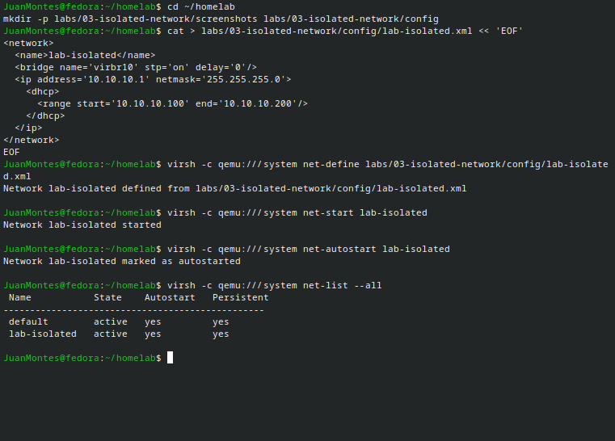
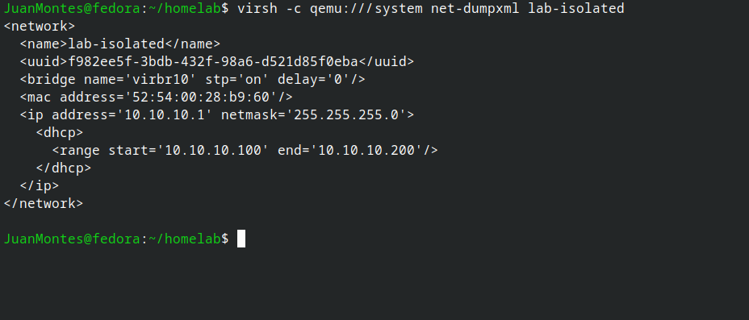
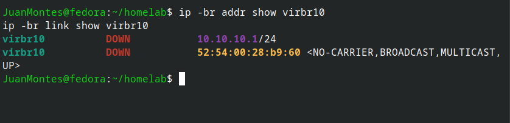
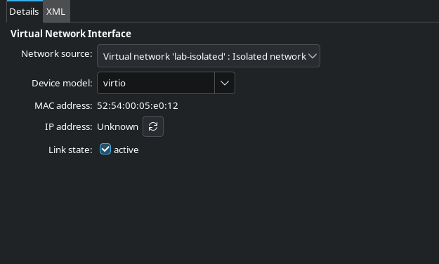
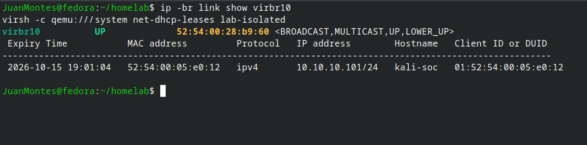
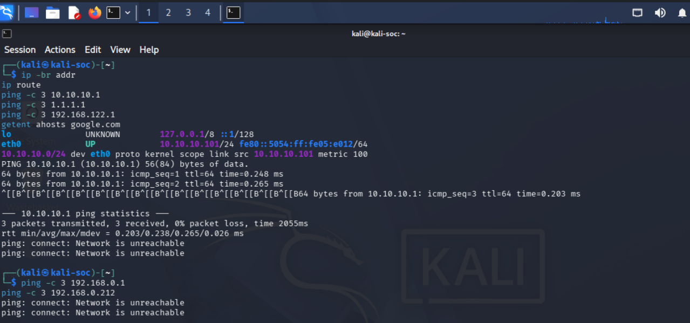

# Lab 03 — Isolated Virtual Network

## Overview

This lab creates an isolated virtual network on a Fedora Linux host using QEMU/KVM and libvirt, then tests whether the Kali Linux VM from Lab 02 can still reach the internet, the previous NAT network, or the home network once it is attached to it.

The objective was to build a closed network segment that can later host a defender machine and intentionally vulnerable targets, and to collect evidence that guests on it have no route to the outside world.

Lab 02 documented the libvirt `default` NAT network, where Kali had a default route and working internet connectivity. This lab repeats similar tests on the new network so the two results can be compared directly.

---

## Environment

| Component | Details |
|---|---|
| Host operating system | Fedora KDE 44 |
| Guest operating system | Kali Linux Rolling |
| VM name | Kali-2026 |
| Guest hostname | kali-soc |
| New virtual network | `lab-isolated` |
| Virtual bridge | `virbr10` |
| Bridge IPv4 address | `10.10.10.1/24` |
| DHCP range | `10.10.10.100` to `10.10.10.200` |
| libvirt connection | `qemu:///system` |

### Network design

```text
                +---------------------------+
                |  Fedora host              |
                |                           |
                |   virbr10 (10.10.10.1)    |
                |        |                  |
                +--------|------------------+
                         |
              lab-isolated (10.10.10.0/24)
                         |
                  kali-soc (10.10.10.101)

   No forwarding: no route to the internet, the NAT network or the home network
```

---

## 1. Defining the Network

The network was described in an XML file, stored in this repository at [`config/lab-isolated.xml`](config/lab-isolated.xml):

```xml
<network>
  <name>lab-isolated</name>
  <bridge name='virbr10' stp='on' delay='0'/>
  <ip address='10.10.10.1' netmask='255.255.255.0'>
    <dhcp>
      <range start='10.10.10.100' end='10.10.10.200'/>
    </dhcp>
  </ip>
</network>
```

### What the definition means

- `<bridge name='virbr10'>` creates a virtual switch on the host. A different bridge name and address range from the `default` network (`virbr0`, `192.168.122.0/24`) keeps the two networks separate.
- `<ip address='10.10.10.1' netmask='255.255.255.0'>` gives the bridge an address in `10.10.10.0/24`. Guests use it as their local gateway address.
- `<dhcp>` runs a DHCP service on the network so guests receive addresses automatically.
- The definition has **no `<forward>` element**. In the `default` network this element enables NAT. Leaving it out means libvirt sets up no path from the bridge to other networks.

---

## 2. Creating the Network

Commands used on the host:

```bash
virsh -c qemu:///system net-define labs/03-isolated-network/config/lab-isolated.xml
virsh -c qemu:///system net-start lab-isolated
virsh -c qemu:///system net-autostart lab-isolated
virsh -c qemu:///system net-list --all
```

- `net-define` saves the network permanently.
- `net-start` creates the bridge and starts DHCP now.
- `net-autostart` starts the network automatically on host boot.



*Screenshot 01: Both networks are active, with autostart and persistence enabled.*

---

## 3. Verifying the Network on the Host

Commands used:

```bash
virsh -c qemu:///system net-dumpxml lab-isolated
virsh -c qemu:///system net-info lab-isolated
ip -br addr show virbr10
ip -br link show virbr10
```



*Screenshot 02: The stored network definition contains no `<forward>` element.*



*Screenshot 03: The `virbr10` bridge on the host before any VM was attached.*

### Findings

- Network name: `lab-isolated`, active, persistent, autostart enabled
- Bridge: `virbr10` with address `10.10.10.1/24`
- The stored XML contains no `<forward>` element. libvirt added a `<uuid>` and a `<mac>` element but nothing that forwards traffic.
- The `<mac>` value in the XML (`52:54:00:28:b9:60`) matches the MAC address reported by `ip link` for `virbr10`, confirming that the host bridge is the one libvirt defined.
- Before any VM was attached, `virbr10` showed `DOWN` with `NO-CARRIER`. This is expected: a bridge with nothing connected has no active link.

---

## 4. Attaching Kali to the Isolated Network

Kali was shut down, its network adapter was changed in virt-manager to use the virtual network `lab-isolated`, and it was started again.



*Screenshot 04: Kali's network adapter set to `lab-isolated`.*

With Kali running, the host showed:

```bash
ip -br link show virbr10
virsh -c qemu:///system net-dhcp-leases lab-isolated
```



*Screenshot 05: `virbr10` is now `UP`, and the DHCP lease shows `kali-soc` at `10.10.10.101`.*

### Findings

- `virbr10` changed from `DOWN` / `NO-CARRIER` to `UP` / `LOWER_UP` once Kali was attached.
- The DHCP lease table lists `kali-soc` with MAC address `52:54:00:05:e0:12` and address `10.10.10.101/24`.
- The lease MAC address matches the MAC address recorded for Kali's network interface in Lab 02, so the same VM and virtual NIC were used.

---

## 5. Isolation Tests from Kali

Commands used inside Kali:

```bash
ip -br addr
ip route
ping -c 3 10.10.10.1
ping -c 3 1.1.1.1
ping -c 3 192.168.122.1
ping -c 3 192.168.0.1
ping -c 3 192.168.0.212
getent ahosts google.com
```



*Screenshot 06: Connectivity tests from Kali on `lab-isolated`.*

### Results

| Test | Result |
|---|---|
| `ip -br addr` | `eth0` has `10.10.10.101/24` |
| `ip route` | Only `10.10.10.0/24 dev eth0`; no `default` route |
| `ping 10.10.10.1` (the bridge) | 3 of 3 replies, about 0.2 ms |
| `ping 1.1.1.1` (internet) | `Network is unreachable` |
| `ping 192.168.122.1` (old NAT gateway) | `Network is unreachable` |
| `ping 192.168.0.1` (home router) | `Network is unreachable` |
| `ping 192.168.0.212` (device on the home network) | `Network is unreachable` |
| `getent ahosts google.com` | No results |

### What this demonstrates

The routing table contains only the connected `10.10.10.0/24` route. With no default route, Kali has no next hop for any destination outside that subnet, so the kernel rejects those pings immediately with `Network is unreachable`, before any packet is sent.

This differs from a timeout or `100% packet loss`, which would mean a route existed but nothing answered. Here the guest itself has no route, which is the expected result of a network with no forwarding.

DNS lookup returned nothing, consistent with Kali having no DNS server and no path to one.

### Comparison with Lab 02 (NAT network)

| | Lab 02 (`default`, NAT) | Lab 03 (`lab-isolated`) |
|---|---|---|
| Kali address | `192.168.122.195/24` | `10.10.10.101/24` |
| Default route | `via 192.168.122.1` | none |
| Ping to the gateway or bridge | works | works |
| Ping to `1.1.1.1` | works (about 148 ms) | `Network is unreachable` |
| DNS resolution | works | no results |
| libvirt `<forward>` element | NAT enabled | absent |

---

## 6. Update: Dual-NIC Configuration

After these tests, Kali kept its `lab-isolated` adapter and was given a second VirtIO adapter on the `default` NAT network. `eth0` stays on `lab-isolated` at `10.10.10.101/24`, and `eth1` uses NAT at `192.168.122.130/24` and carries the default route.

Full procedure, routing table and connectivity tests: [`dual-nic-recovery.md`](dual-nic-recovery.md).

---

## Evidence

Screenshots are stored in the `screenshots/` folder.

| File | What it shows |
|---|---|
| [`01-network-list.png`](screenshots/01-network-list.png) | Both libvirt networks active |
| [`02-isolated-network-xml.png`](screenshots/02-isolated-network-xml.png) | Stored XML with no `<forward>` element |
| [`03-host-bridge.png`](screenshots/03-host-bridge.png) | `virbr10` before a VM was attached |
| [`04-kali-nic-isolated.png`](screenshots/04-kali-nic-isolated.png) | Kali's NIC set to `lab-isolated` |
| [`05-host-bridge-and-lease.png`](screenshots/05-host-bridge-and-lease.png) | `virbr10` up and Kali's DHCP lease |
| [`06-isolation-tests.png`](screenshots/06-isolation-tests.png) | Connectivity tests from Kali |

---

## Skills Practised

- Writing a libvirt network definition in XML.
- Creating and managing virtual networks with `virsh`.
- Understanding the difference between NAT and isolated networks.
- Verifying a virtual bridge from the host with `ip` and `virsh`.
- Reading a routing table to explain why traffic cannot leave a network.
- Designing tests with predicted results before running them.
- Collecting evidence and documenting a reproducible lab.

---

## Limitations

- The bridge has an IP address (`10.10.10.1`), so the host can reach guests and guests can reach the bridge address. Guests are isolated from other networks, not from the host.
- The tests show the guest's view only: it has no route out. They do not test the host's firewall or forwarding settings, which also affect isolation.
- Only ICMP pings to selected addresses and one DNS lookup were tested. No port scans or other protocols were tested, and IPv6 reachability was not tested.
- With only the `lab-isolated` adapter, Kali has no internet access. This was later resolved by adding a second adapter on the NAT network (see [`dual-nic-recovery.md`](dual-nic-recovery.md)). The isolation results above apply to the single-adapter configuration.
- Results are valid for the configuration at the time of testing.

---

## Next Steps

- Install an Ubuntu VM as a defender machine on `lab-isolated` (Lab 04).
- Test traffic between Kali and the defender, and observe it with `tcpdump`.
- Review host firewall rules and IP forwarding settings that affect the isolation of `virbr10`.
- ~~Add a second network adapter for controlled updates.~~ Done: see [`dual-nic-recovery.md`](dual-nic-recovery.md).
- Before running exercises with vulnerable targets, disconnect the NAT adapter or confirm that IP forwarding is disabled on Kali, so it cannot route between the two networks.
