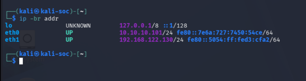
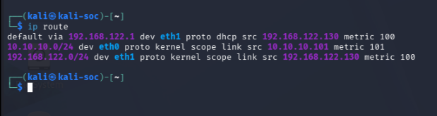
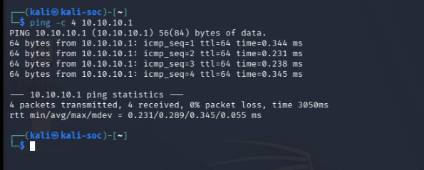
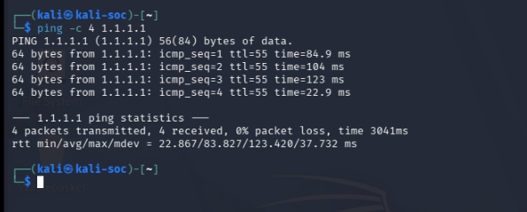

# Network Recovery — Restoring Kali Internet Access

Part of [Lab 03 — Isolated Virtual Network](README.md).

## Overview

This document records the recovery of internet connectivity for the Kali Linux virtual machine after its network adapter was connected exclusively to the isolated `lab-isolated` libvirt network.

The solution was to retain the isolated adapter and add a second virtual network adapter connected to the existing libvirt `default` NAT network.

This configuration allows Kali to access the internet while maintaining a separate interface for authorised cybersecurity exercises on the isolated lab network.

---

## Environment

| Component | Details |
|---|---|
| Host operating system | Fedora KDE 44 |
| Virtualisation | QEMU/KVM, libvirt and virt-manager |
| Kali VM name | `Kali-2026` |
| Kali hostname | `kali-soc` |
| Isolated network | `lab-isolated` |
| Isolated subnet | `10.10.10.0/24` |
| Isolated gateway | `10.10.10.1` |
| NAT network | `default` |
| NAT subnet | `192.168.122.0/24` |
| NAT gateway | `192.168.122.1` |

---

## Problem

Kali originally had a single virtual network adapter connected to `lab-isolated`.

Because the isolated network had no external forwarding configured, Kali lost internet connectivity when its adapter was moved away from the `default` NAT network.

The isolated interface also had no IPv4 address initially because NetworkManager had no saved connection profile for it.

---

## Recovery Procedure

### 1. Inspect the existing interfaces

On Fedora, the following command was used to inspect the virtual network adapters:

```bash
virsh -c qemu:///system domiflist Kali-2026
```

Initially, only one adapter was present, connected to `lab-isolated`.

The existing network definitions were checked using:

```bash
virsh -c qemu:///system net-list --all
```

Both `default` and `lab-isolated` were active and persistent.

### 2. Add a second NAT adapter

Kali was shut down before its virtual hardware was changed.

The following command added a second adapter to the existing NAT network:

```bash
virsh -c qemu:///system attach-interface \
  --domain Kali-2026 \
  --type network \
  --source default \
  --model virtio \
  --config
```

The command returned:

```text
Interface attached successfully
```

The interface configuration was checked again:

```bash
virsh -c qemu:///system domiflist Kali-2026
```

The resulting adapters were:

| Network | MAC address | Purpose |
|---|---|---|
| `lab-isolated` | `52:54:00:05:e0:12` | Isolated lab exercises |
| `default` | `52:54:00:d3:cf:a2` | NAT internet access |

### 3. Start Kali and inspect its interfaces

Kali was started using:

```bash
virsh -c qemu:///system start Kali-2026
```

Inside Kali, the interfaces were inspected with:

```bash
ip -br addr
```

Initially, `eth1` received the NAT address `192.168.122.130/24`, while `eth0` had no IPv4 address.

The routing table confirmed that the default route already used the NAT interface:

```bash
ip route
```

The default gateway was `192.168.122.1` through `eth1`.

### 4. Configure the isolated interface

NetworkManager was inspected using:

```bash
nmcli device status
nmcli connection show
```

The results showed that `eth0` was disconnected and had no saved connection profile.

A connection profile was created:

```bash
sudo nmcli connection add \
  type ethernet \
  ifname eth0 \
  con-name lab-isolated \
  ipv4.method auto \
  ipv6.method auto
```

The profile was activated:

```bash
sudo nmcli connection up lab-isolated
```

NetworkManager successfully activated the connection and obtained an IPv4 address through DHCP.

---

## Final Network Configuration

The final interface configuration was verified using:

```bash
ip -br addr
```

The observed addresses were:

| Interface | IPv4 address | Network |
|---|---|---|
| `eth0` | `10.10.10.101/24` | `lab-isolated` |
| `eth1` | `192.168.122.130/24` | `default` NAT |



*Screenshot 07: Both interfaces are `UP`, each with an IPv4 address on its own network.*

The final routing table was:

```text
default via 192.168.122.1 dev eth1 proto dhcp src 192.168.122.130 metric 100
10.10.10.0/24 dev eth0 proto kernel scope link src 10.10.10.101 metric 101
192.168.122.0/24 dev eth1 proto kernel scope link src 192.168.122.130 metric 100
```



*Screenshot 08: The default route uses the NAT adapter (`eth1`); the isolated subnet is reached directly through `eth0`.*

This confirms that the isolated subnet has its own directly connected route and that the default route uses the NAT adapter.

---

## Connectivity Tests

### 1. Isolated gateway connectivity

Command:

```bash
ping -c 4 10.10.10.1
```

Result:

- Packets transmitted: 4
- Packets received: 4
- Packet loss: 0%
- Average round-trip time: 0.289 ms



*Screenshot 10: Kali reaches the isolated network's host-side gateway through `eth0`.*

**Conclusion:** Kali can communicate with the host-side gateway of the isolated network.

### 2. NAT gateway connectivity

Command:

```bash
ping -c 4 192.168.122.1
```

Result:

- Packets transmitted: 4
- Packets received: 4
- Packet loss: 0%
- Average round-trip time: 0.257 ms

**Conclusion:** Kali can communicate with the libvirt NAT gateway.

### 3. External IPv4 connectivity

Command:

```bash
ping -c 4 1.1.1.1
```

The final test, performed inside Kali after both interfaces were configured, returned:

- Packets transmitted: 4
- Packets received: 4
- Packet loss: 0%
- Average round-trip time: 83.827 ms



*Screenshot 09: Kali reaches an external IPv4 address through the NAT adapter (`eth1`).*

**Conclusion:** Kali can reach an external IPv4 address through its NAT connection.

### 4. DNS resolution

Command:

```bash
getent ahosts google.com
```

The command returned IPv4 and IPv6 addresses for `google.com`.

**Conclusion:** System name resolution was working during the test.

---

## Security Considerations

- The isolated network remains separate from the existing NAT network.
- No external forwarding was added to `lab-isolated`.
- The NAT adapter provides Kali with internet access, but does not intentionally configure routing between the two virtual networks.
- Network separation reduces the risk of accidentally testing real devices.
- Connectivity to the host-side isolated gateway does not, by itself, prove complete isolation from every host or network path.
- Further isolation testing should be performed before making stronger security claims.

All future scanning and service-testing exercises must remain within the authorised lab environment.

---

## Evidence

Screenshots are stored in the [`screenshots/`](screenshots/) folder. Numbering continues from the Lab 03 screenshots.

| File | What it shows | Status |
|---|---|---|
| [`07-kali-dual-network-interfaces.png`](screenshots/07-kali-dual-network-interfaces.png) | Both interfaces and their IPv4 addresses | Captured |
| [`08-kali-dual-network-routing.png`](screenshots/08-kali-dual-network-routing.png) | Routing table showing the NAT default route and isolated subnet route | Captured |
| [`09-kali-internet-connectivity.png`](screenshots/09-kali-internet-connectivity.png) | Successful ping to `1.1.1.1` from inside Kali | Captured |
| [`10-kali-isolated-gateway.png`](screenshots/10-kali-isolated-gateway.png) | Successful ping to `10.10.10.1` | Captured |

---

## Lessons Learned

1. An isolated virtual network does not automatically provide internet access.
2. A virtual machine can use multiple virtual network adapters for different networking purposes.
3. NetworkManager needs an active connection profile to configure an Ethernet interface automatically.
4. The routing table helps determine which interface will carry traffic to a destination.
5. Testing a gateway, an external IP address and DNS resolution verifies different aspects of connectivity.
6. A successful connectivity test provides evidence of reachability, but does not independently prove network isolation.

---

## Outcome

**Status: Recovery successful.**

Kali now has two working virtual network interfaces:

- `eth0` connects to `lab-isolated` at `10.10.10.101/24`.
- `eth1` connects to the `default` NAT network at `192.168.122.130/24`.

The isolated gateway, NAT gateway, external IPv4 connectivity and DNS resolution were all successfully tested.

The lab environment is ready for the next stage: creating an Ubuntu target VM on `lab-isolated` and conducting controlled network discovery and port-scanning exercises.
